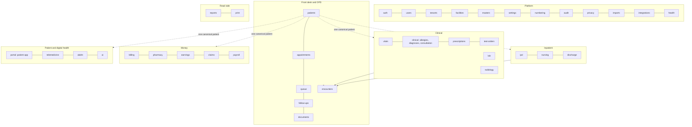
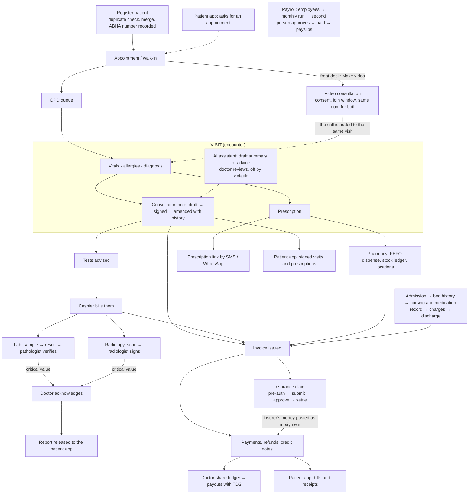

# MedOS: current architecture (all modules)

Status: as built on 2026-11-03. This replaces the early-October picture in `mlp1-design.md` and `diagrams.html` for everything added since. Mermaid diagrams render in VS Code (Markdown Preview Mermaid Support) and on GitHub.

Verified: full automated suite passes (API 1,018, web 19, shared 11). Not verified: Docker and CI have never been run; the AI assistant has only been run against a local stand-in; ABDM is connection and ABHA recording only.

## 1. System context and containers

```mermaid
flowchart LR
  subgraph Staff["Staff (browser)"]
    S1[Reception · Doctor · Nurse · Cashier · Pharmacist · Manager · Administrator]
    S2[Lab technician · Pathologist · Radiographer · Radiologist · Claims officer · Payroll officer]
  end
  PAT[Patient<br/>phone browser]
  subgraph Web["Web app (Next.js 15)"]
    UI[Staff screens<br/>app router, TanStack Query, i18n en/bn/hi]
    PUI["Patient app /patient<br/>own cookie medos_pt"]
    BFF[Session routes<br/>httpOnly cookies medos_at, medos_rt]
    GW[Same-origin gateways<br/>/api/proxy staff · /api/patient patient<br/>CSRF header, sign-in routes not proxied]
  end
  Staff -->|HTTPS| UI
  PAT -->|HTTPS| PUI
  UI --> BFF & GW
  PUI --> GW
  subgraph API["API (NestJS 11, /api/v1, modular monolith)"]
    G1[Global guard: staff token + permissions<br/>re-read from the database every request]
    G2[Patient guard: patient session only]
    MOD[38 domain modules]
    G1 --> MOD
    G2 --> MOD
  end
  GW -->|Bearer| G1
  GW -->|patient Bearer| G2
  MOD -->|Prisma + SQL, row-level security| PG[(PostgreSQL 17<br/>source of truth)]
  MOD -->|files| FS[(Local disk, S3 later)]
  MOD -.->|outbound, SSRF-guarded| EXT
  subgraph EXT["Outside services (all optional, each switched on by the hospital)"]
    SMS[SMS / WhatsApp provider]
    HOOK[Webhooks to other systems]
    OCR[OCR service]
    VID[Video service]
    AIP[AI provider]
    ABDM[ABDM gateway: connection test only]
  end
```

## 2. Module map

## 3. How the workflows connect

## 4. Cross-cutting design

| Concern | How it is done |
|---|---|
| Tenancy | Tenant and facility come only from the session (staff) or the patient session. Every query is tenant-scoped; composite foreign keys; PostgreSQL row-level security on every table, including the newest ones. |
| Authorization | Permission-based roles from one list (`packages/shared/src/permissions.ts`); a test fails if any route does not declare public, any-authenticated or required permissions. Patient routes use their own guard. |
| Integrity | Services and PostgreSQL both enforce the rules: append-only triggers (audit, signed notes, reports, ledger), exclusion constraints, state guards, no deletes of clinical or financial rows. |
| Audit | Every important mutation writes an audit event in the same transaction; patient actions are recorded with `actor: PATIENT`; no clinical text or secrets in the log. |
| Money | Decimal everywhere; invoices frozen once issued; insurer and patient payments use the same ledger; idempotency keys on payments, refunds, settlements, dispensing. |
| Secrets | Provider keys (OCR, SMS, ABDM, AI) are encrypted, write-only and never sent to a different address than the one they were entered for. |
| Outbound calls | One guard for every call that leaves the server (private addresses refused in production). |
| Background work | Workers poll with SKIP LOCKED for reminders, prescription delivery and webhooks. |
| Printing | One document model renders HTML or PDF; reprints are marked as duplicates; each print is audited. |
| Localisation | English, Bengali, Hindi for staff screens; the patient app is English. |

## 5. Modules by status

| Status | Modules |
|---|---|
| Built and tested | All of Platform, Front desk and OPD, Clinical, Inpatient, Money, Reports and print; laboratory, radiology (reporting only), claims, payroll, patient app (web), telemedicine (link-based), AI assistant (drafts only) |
| Partly built | ABDM: ABHA numbers and a gateway connection test; no verification, linking or consent flows |
| Not built | Image storage and viewer (PACS), electronic insurer submission, native store app, online payment, Form 16 and PF/ESI challans, attendance and leave, Swasthya Sathi, theatre management (only a small procedure record with implants and consumables is built: docs/procedures.md), full accounting |

## 6. Deployment

Local development runs the web app on port 3000, the API on 4000 and PostgreSQL on 54329. For a demo, a Cloudflare quick tunnel can expose the web app only; the API and database stay private. Docker images, compose and CI files exist but have never been built or run. A real deployment needs HTTPS, a managed PostgreSQL with point-in-time recovery and encrypted backups, S3 storage, a shared rate limiter, a production web build and secrets in a secrets manager.
